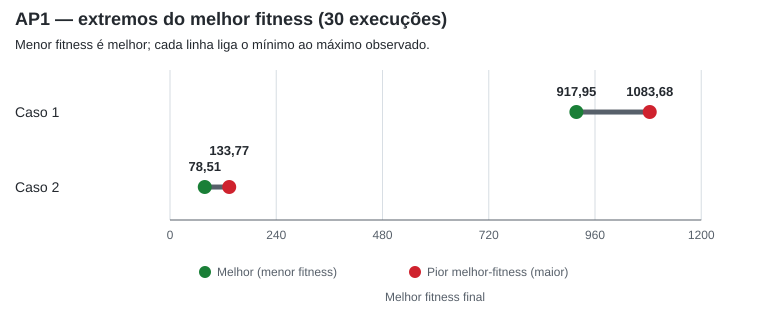

# Relatório – Atividade Prática 1: Algoritmos Genéticos

**Aluno:** Louis Guilherme Marinho de Resende  
**Matrícula:** 2025.10204

## Objetivo e estratégia

Foram comparadas duas configurações de algoritmo genético real para minimizar a função de Rastrigin em 100 dimensões, no intervalo [-5.12, 5.12]. A população inicial foi gerada uniformemente ao acaso. A seleção utiliza ranking linear de Baker para minimização, com pressão 1,7. Cada geração mantém um indivíduo de elite e substitui os demais indivíduos por descendentes. A taxa de crossover é 0,9, e a taxa de mutação por variável é 1/n = 0.0100.

## Parâmetros

| Parâmetro | Valor |
|---|---:|
| Tamanho da população | 100 |
| Dimensões | 100 |
| Gerações | 300 |
| Intervalo | [-5.12, 5.12] |
| Taxa de crossover | 0.9 |
| Taxa de mutação por gene | 0.0100 |
| Elitismo | 1 indivíduo |
| Pressão do ranking linear | 1.7 |
| Execuções por caso | 30 |
| Semente-mestra | 309 |

### Justificativa dos parâmetros

Os parâmetros foram definidos como escolhas heurísticas para este experimento, sem uma busca sistemática de ajuste. A representação real foi escolhida por se tratar de variáveis contínuas e por permitir o uso direto dos operadores numéricos. A população de 100 indivíduos oferece diversidade para a busca sem tornar excessivo o custo de cada geração; o limite de 300 gerações segue o enunciado.

A taxa de crossover de 0,9 favorece a recombinação frequente dos progenitores. A taxa de mutação por gene, 1/n, corresponde a uma expectativa de aproximadamente uma variável mutada por descendente, mantendo perturbações ocasionais sem alterar todos os genes. No Caso 1, o desvio-padrão gaussiano de 10% da amplitude do intervalo permite perturbações de magnitude moderada; no Caso 2, eta=20 define uma mutação polinomial mais concentrada em alterações menores, mas que ainda pode gerar passos maiores.

O elitismo de 1 indivíduo preserva o melhor da geração sem impedir a renovação do restante da população. A pressão 1,7 no ranking linear foi escolhida para favorecer indivíduos melhores sem tornar a seleção determinista. Os dois pares de operadores foram escolhidos para comparar estratégias distintas de recombinação e perturbação, mantendo os demais parâmetros iguais para facilitar a comparação.

## Operadores

- **Caso 1:** crossover BLX-alpha (alpha=0.5); mutação gaussiana (sigma=10% do intervalo).
- **Caso 2:** crossover aritmético (pesos por gene); mutação polinomial (eta=20).

Os casos compartilham os mesmos parâmetros gerais e as mesmas sementes dentro de cada par. A ordem de execução de cada par é aleatorizada. O crossover combina dois progenitores, e a mutação é aplicada ao descendente.

## Resultados

As estatísticas abaixo são calculadas sobre o melhor fitness final de cada execução. O desvio-padrão é amostral (ddof=1). O “pior melhor-fitness” é o maior dos melhores fitness obtidos nas execuções, não o pior indivíduo da população final.

| Caso | Melhor fitness | Pior melhor-fitness | Média | Desvio-padrão | Tempo médio (s) |
|---|---:|---:|---:|---:|---:|
| Caso 1 | 917.95003 | 1083.6791 | 988.83222 | 37.5704 | 1.9244 |
| Caso 2 | 78.508436 | 133.77387 | 101.60758 | 16.157844 | 1.8249 |

### Extremos do melhor fitness por execução

O gráfico mostra, para cada caso, o menor e o maior valor de melhor fitness obtidos nas 30 execuções. Como a função é minimizada, valores menores são melhores. O extremo superior é o pior entre os melhores resultados de cada execução, não o pior indivíduo de uma população.

### Indivíduos extremos observados

**Caso 1 — melhor (execução 10, f=917.95003):**

`[1.1491, -0.0558, 1.1377, 1.0313, -0.9427, -3.0511, -0.9856, -0.1275, 1.4963, 0.1700, -0.1019, -0.0633, -1.0555, -0.1501, -0.8862, 2.7087, 0.0432, 2.0517, -0.9022, 2.7364, -0.8902, 2.5886, -0.8159, -0.8671, 1.2859, -0.2186, -1.1447, 1.4150, -0.3176, -3.0334, 1.6475, 0.1159, 1.2027, -3.3249, -3.2094, 0.9133, -1.2800, -0.2436, 1.0063, -0.9916, -1.1011, -0.1703, -0.6751, -0.9600, 1.0052, -1.9824, -1.1968, -1.7810, 0.7523, 0.7698, -0.9484, -0.0310, -0.1662, -1.2203, 0.2235, 0.1695, 2.7724, -1.1485, -1.8139, -1.3536, -0.7721, 1.2952, 0.0346, 2.0188, -0.6590, 0.1801, -0.4316, -0.7416, -0.6284, 0.3868, -0.1508, -1.8735, 2.1740, 0.5364, -2.1639, -0.7765, -2.8074, 2.8697, -0.5425, 1.2279, -1.2379, 0.9199, -1.1547, -0.7227, 0.1198, -3.1351, -5.1200, -1.9895, 1.8804, -2.2168, 1.3662, -3.0521, -0.8885, 0.0806, -1.4763, -2.6202, 1.6299, -1.8626, 1.2412, 0.9608]`

**Caso 1 — pior melhor-indivíduo (execução 28, f=1083.6791):**

`[-1.7097, -1.1526, 4.9298, -2.0277, 0.0835, -1.7713, -5.1200, 0.9442, -0.1033, 1.0717, 2.8762, 0.7420, -0.3075, -0.5178, -0.5240, -0.7271, 3.6915, -0.1323, 0.0728, -1.3397, -0.6256, 3.7020, -1.8545, -2.3876, -0.3425, -2.9982, 0.3324, 2.4384, -0.2838, 1.5831, 1.0354, 0.3781, -1.1692, 1.0951, 0.1990, 1.0660, 2.2760, -0.1059, -0.1366, -3.4647, -2.8103, -0.9237, -0.9799, -2.0240, 0.4691, 0.8923, -0.7312, 0.2433, 3.0653, 1.8633, 1.0363, 1.2406, -1.9526, 1.1684, -2.0137, 0.1393, -0.5032, -2.4642, 0.3578, -3.8795, 0.3530, -2.8178, -0.8130, -3.8848, -3.6042, -0.5888, -2.7329, 2.2654, -0.9298, 0.1745, 0.9943, 2.0603, 1.0195, 0.5970, 0.8367, -0.2871, -0.0409, -1.7981, 0.8418, -0.3508, -0.7741, 1.2249, 0.8301, -0.6708, -0.2765, -0.3313, 0.3241, 0.1263, 1.0937, 1.0968, -0.6865, 1.7604, -1.1417, -2.2991, 1.9201, -1.0660, -2.0887, 2.0634, 2.1661, 1.0148]`

**Caso 2 — melhor (execução 19, f=78.508436):**

`[0.9579, 0.9883, -0.0102, -0.0552, 0.0714, -0.0817, -0.0756, 0.0303, -0.0704, 0.0430, -0.8591, 1.0366, -0.9410, -0.0079, -0.0867, -0.0217, 0.0532, 0.0127, -0.0553, 0.9786, -0.0684, -0.9524, 0.0136, 0.0551, -0.0028, -0.0018, 1.0031, -0.0303, -1.0378, 1.0164, -0.0418, 0.9351, -0.9881, -0.0056, 0.0266, 0.9716, 0.0419, 0.0458, 0.0558, 0.0606, -0.0419, -0.0354, 0.9816, -0.1239, -0.0392, -0.9993, 0.0557, 0.0499, -0.0519, -1.0048, 0.9816, -0.0836, 0.9141, 0.0960, 0.0061, -0.9527, -0.0663, -0.9855, 0.0068, 0.0508, 0.8403, 0.9822, 0.0492, -0.0714, -0.0429, -1.0376, 1.0095, 0.0058, 1.0210, 0.0368, 0.0517, -0.0275, -0.0752, -0.0069, -0.0538, 0.8914, 0.0236, -0.0312, -0.0050, -0.0394, 0.0582, 1.0062, 0.0833, -1.0365, -0.0363, -1.0191, 0.0221, 0.9715, 0.0321, 0.0256, -0.0044, 0.0161, -0.0012, 0.0117, -0.0225, 0.0063, -0.0236, 0.0785, 0.0656, -0.0478]`

**Caso 2 — pior melhor-indivíduo (execução 16, f=133.77387):**

`[-0.0503, -0.0991, -0.0103, 0.9619, -0.0300, 0.0677, 0.8786, -0.0593, 0.0156, 0.0667, 0.0667, -0.1688, -1.0040, -0.0764, -0.9952, 0.0628, -0.0204, 0.9324, 0.1685, -0.9025, 0.0509, 0.0176, -0.0830, -0.0220, 1.0407, 0.9425, 1.0110, -1.0207, -1.0188, 0.0395, -0.0789, 0.9192, 1.0444, 0.0497, -0.0954, 0.9661, 0.0444, 0.0320, 0.0435, -0.0869, 0.0686, -0.1954, 0.0009, 1.0133, 0.0311, 0.0454, 0.0411, -0.0099, -0.0851, -0.9542, 0.1458, -0.0239, -0.0994, -0.0489, -0.9426, -0.1211, -0.0333, 0.0249, 0.9578, 0.0748, 0.0251, 0.0844, 0.9402, 0.9852, 0.1568, 0.0067, -0.0523, -0.0243, 0.0990, 0.9059, 0.9486, 0.0230, -0.1519, -0.0374, -0.0626, -0.2061, -0.9926, -0.8858, -0.8997, -0.9031, -0.9061, -0.9744, -0.0621, 0.0079, -0.0254, -0.0236, -1.0173, -0.0379, 1.0639, -0.1019, 0.0285, -0.9157, -0.8696, 0.9418, -0.0358, -1.0015, 0.9640, -0.0474, -0.0653, 0.0589]`

### Teste t pareado bilateral

- Hipóteses: H0: C1 = C2; H1: C1 != C2.
- Nível de significância: alpha = 0.05.
- Estatística t: 111.61988.
- Valor-p: 9.399297e-40.
- Diferença média pareada (C1 - C2): 887.22464.
- IC de 95% da diferença média (C1 - C2): [870.96788, 903.48141].
- Decisão: rejeita-se H0; há evidência de diferença estatisticamente significativa.

## Discussão e conclusão

### Interpretação dos resultados

O Caso 2 obteve média de fitness 101.61, frente a 988.83 no Caso 1, o que representa uma redução média de 89.72% (menor é melhor). Em 30 de 30 pares, o Caso 2 terminou com fitness menor. A dispersão dos resultados também foi menor no Caso 2: desvio-padrão de 16.16, contra 37.57 no Caso 1, uma redução de 56.99%.

O teste t pareado resultou em t(29) = 111.6199 e p = 9.399e-40. Como p < 0.05, rejeita-se H0 ao nível de 5%. O intervalo de confiança de 95% para a diferença média C1 - C2, [870.97, 903.48], é positivo e consistente com o melhor resultado médio do Caso 2. O pareamento compara as configurações sob a mesma semente em cada repetição.

Os resultados comparam os operadores em conjunto; não isolam o efeito individual do crossover ou da mutação. Portanto, não é possível atribuir a diferença a um operador específico. O crossover aritmético gera combinações convexas dos progenitores, enquanto a mutação polinomial depende da distância aos limites e do parâmetro eta. No Caso 1, o BLX-alpha permite amostrar ao redor do intervalo dos pais, e a mutação gaussiana usa desvio-padrão de 1.024 unidades. O melhor desempenho observado do Caso 2 é uma conclusão válida para estes parâmetros e este experimento, não uma indicação de superioridade universal desses operadores.

### Problemas encontrados durante o desenvolvimento

Foi necessário garantir que o ranking linear fosse orientado para minimização: o indivíduo com menor valor de Rastrigin deve receber maior probabilidade de seleção. Um teste unitário verificou a ordem das probabilidades e revelou a inversão inicial dos postos. A atribuição dos postos foi corrigida, e os testes passaram. Também foi importante limitar os descendentes ao intervalo permitido, pois operadores de crossover e mutação podem propor valores fora dele. As execuções pareadas reutilizam a semente de cada par para iniciar os casos com a mesma população. Além disso, a ordem aleatória reduz o risco de favorecer sistematicamente um caso pela ordem de execução.

### Considerações e conclusão

O Caso 2 foi claramente melhor nesta configuração: sua média foi 89.72% menor, e o teste pareado indicou diferença estatisticamente significativa. Apesar disso, o melhor fitness observado foi 78.51, acima do mínimo global (0). Portanto, o experimento não encontrou o ótimo global da função em 100 dimensões. Os tempos médios foram 1.924 s (Caso 1) e 1.825 s (Caso 2). Essa pequena diferença descritiva não foi submetida a teste estatístico e pode variar com a carga do computador.

Como limitações, foram avaliadas apenas duas combinações de operadores, uma configuração de parâmetros e 30 pares. O teste t também pressupõe que as diferenças pareadas sejam adequadas a uma análise paramétrica; essa distribuição não foi avaliada aqui. Experimentos futuros podem variar separadamente crossover e mutação, testar outros parâmetros e orçamentos de busca e inspecionar a distribuição das diferenças para avaliar a robustez das conclusões.

Os tempos medidos dependem do computador e da carga do sistema. As execuções completas estão em `execucoes.csv`, e `resultados.json` preserva os dados e vetores em formato estruturado.
